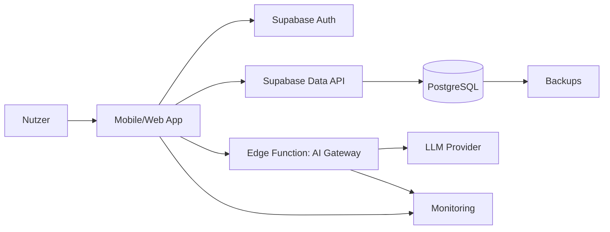
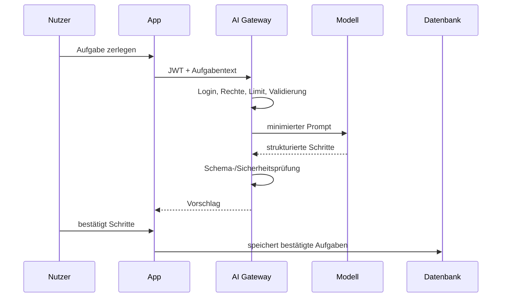

# FocusFlow – Architektur

## Systemkontext



## Entscheidungen

### Client

Beispielhaft Cross-Platform-App mit einer gemeinsamen Codebasis. Die konkrete Wahl zwischen Expo/React Native, Flutter oder Web bleibt ein ADR und hängt von den benötigten Gerätefunktionen ab.

### Backend

Supabase für:

- Auth
- PostgreSQL
- Data API
- optionale Edge Functions
- optional Storage

### KI

Ausschließlich über eine serverseitige Edge Function oder einen eigenen Gateway-Service.

## Vertrauensgrenzen

1. Nutzergerät ist nicht vertrauenswürdig.
2. Clientdaten und Uhrzeit müssen validiert werden.
3. JWT beweist Identität, nicht automatisch jede Berechtigung.
4. Datenbank-Grants und RLS entscheiden über Ressourcenzugriff.
5. Service Role und Modellschlüssel bleiben serverseitig.
6. externe Provider sind eigene Datenempfänger und Ausfallpunkte.

## Fokus-Session-Zeitmodell

Eine Session speichert:

- `started_at`
- geplante Dauer
- Status
- optional `ended_at`
- berechnete tatsächliche Dauer

Die UI darf lokal herunterzählen, aber die fachliche Abschlusslogik verwendet persistierte Zeitstempel. Ein Abschluss ist idempotent und darf nur einmal gezählt werden.

## KI-Datenfluss



Rohprompt und Modellantwort werden standardmäßig nicht dauerhaft gespeichert. Technische Metriken können minimiert und zeitlich begrenzt erfasst werden.

## Löschfluss

```text
Nutzer bestätigt Löschung
→ Löschauftrag erstellen
→ neue Sessions/KI-Aufträge sperren
→ fachliche Daten und Storage löschen
→ Drittanbieteraufträge ausführen
→ Auth-Sessions widerrufen
→ Auth-Account löschen
→ Abschluss protokollieren
```

## Fehler- und Ausfallverhalten

### Supabase nicht erreichbar

- lokale Eingabe nicht still verlieren;
- verständliche Fehlermeldung;
- kontrollierter Retry;
- keine falsche Erfolgsmeldung.

### KI-Provider nicht erreichbar

- Kern-App bleibt nutzbar;
- KI-Funktion zeigt sicheren Fallback;
- keine Endlosschleife;
- Kosten-/Timeout-Grenze.

### App wird während Session beendet

- aktive Session aus persistenten Daten rekonstruieren;
- Zeit nicht nur aus lokalem Timer ableiten;
- doppelten Abschluss blockieren.

## RPO/RTO für Beispiel

- RPO: maximal 24 Stunden für nicht anderweitig rekonstruierbare Daten
- RTO: Kernservice innerhalb von 4 Stunden wiederherstellbar

Diese Werte sind Beispielziele und müssen an Tarif, Nutzerzahl und Geschäftsrisiko angepasst werden.

## Monitoring

- Registrierung/Login-Erfolg
- Projekt-/Aufgabenfehler
- Sessionstart und -abschluss
- doppelte/inkonsistente Abschlüsse
- p95 API-Latenz
- KI-Fehler, Latenz und Kosten
- Löschaufträge und Retries
- Backupstatus

## Architektur-Freigabe

- [ ] Datenmodell und RLS
- [ ] Zeitmodell und Idempotenz
- [ ] KI-Gateway und Limits
- [ ] Löschfluss
- [ ] Fehler-/Offline-Verhalten
- [ ] Monitoring
- [ ] Backup/Restore
- [ ] ADRs für Client, Backend und Anbieter
